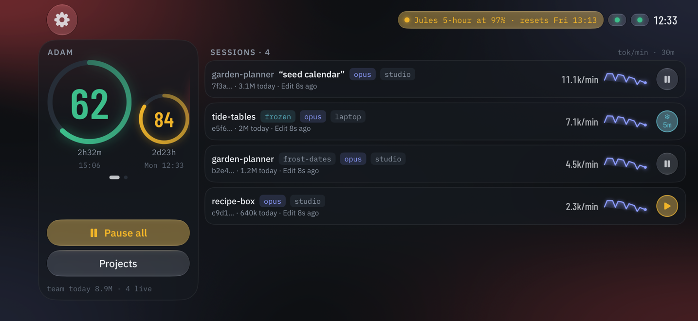

<!-- SPDX-License-Identifier: MIT -->
<!-- Copyright (c) 2026 Even Seal Productions -->

<div align="center">

# claude-usage

**Know how close your Claude account is to its limits — in your terminal, inside Claude Code,
and on your phone and wrist.**

[](https://github.com/drmuzikbpn/usage-deck/actions/workflows/ci.yml)
[](LICENSE)



&nbsp;


*Works with Claude Code. Not affiliated with, endorsed by, or sponsored by Anthropic.*

</div>

### Launch video

https://github.com/user-attachments/assets/4150c424-cedb-4235-abfb-f23ec402f18e

### Walkthrough: the iPhone app in 30 seconds

https://github.com/user-attachments/assets/0f93ea22-bf9a-4794-9a2e-3a686739377d

---

`claude-usage` is a small background service for macOS and Linux. It reads the same usage
numbers `/usage` shows, adds up the tokens your Claude Code sessions spend, and puts both
where you need them:

- **Inside Claude Code** — a one-line warning when a window is getting tight, and MCP tools a
  session can call to check its own budget and slow down before it hits the wall.
- **In your terminal** — `claude-usage status`, token totals by project or model, and pause or
  resume any running session.
- **On your phone, watch and desk** — the free **Usage Deck** apps show every account's rings,
  every live session and its burn rate, and pause or freeze sessions with a tap.

It never sends your data anywhere: the only outside calls are Anthropic's own usage endpoint
and GitHub, to check for signed updates. Phones reach it over your own Wi-Fi with HTTPS pinned
to the daemon's certificate.

<p align="center">
  
</p>

## Install

You need **Node 20+** and **Claude Code** signed in on the machine.

```bash
git clone https://github.com/drmuzikbpn/usage-deck.git
cd usage-deck
npm ci && npm run build
node bin/claude-usage install
```

`install` explains each change and asks before making it. It starts the background service,
adds the Claude Code hook and MCP server, and puts `claude-usage` on your PATH. You can delete
the checkout afterwards: the service keeps itself up to date from signed GitHub releases.

Check it worked:

```bash
claude-usage status
```

Remove everything again with `claude-usage uninstall`.

## Add your phone

1. Get the app:
   - **iPhone + Apple Watch** — *Usage Deck*, free on the App Store (in App Review now; the
     link goes here once it is live). The watch app comes with it. No computer yet? Tap
     **Try the demo**.
   - **Android** — a **dedicated-device dashboard**, not an everyday phone app: it is built to
     run as the kiosk launcher on a spare phone on your desk or wall (Device Owner, so it can
     stay pinned on screen and update itself). That is why it asks for location (Android
     requires it to read the Wi-Fi network name) and permission to install packages (its own
     signed updates). Set-up: [device setup guide](https://github.com/drmuzikbpn/usage-deck/blob/usage-android/docs/device-setup.md);
     APK from the [`deck-` releases](https://github.com/drmuzikbpn/usage-deck/releases).
2. On each machine you want to see, turn on LAN access (an interactive install offers it), then
   pair:

   ```bash
   claude-usage configure lan on    # once, if you skipped it during install
   claude-usage pair
   ```

3. Scan the QR code it shows. That's it — the code works once and expires in five minutes,
   and the token it unlocks never appears on screen.

## Known limitations

- **Your phone or watch must be on the same network as the computer running Claude Code.**
  Remote monitoring talks straight to that computer over your local network; there is no
  cloud relay. To check in from anywhere, put both on a private VPN such as
  [Tailscale](https://tailscale.com) (free for personal use): run
  `claude-usage install --tailscale` and pair again. See
  [Away from home](docs/guide.md#away-from-home-tailscale-optional).
- **It only works with Claude Code for now.** Limits come from your Claude Code sign-in and
  session data from Claude Code's own files. Support for more tools is coming.

## Screenshots

Landscape is where it shines: stand the phone on your desk next to the keyboard.

<p align="center">
  
</p>

| iPhone | Apple Watch | Android desk phone |
| :---: | :---: | :---: |
|  |  |  |
| Portrait works too | Projects at a glance | A wall or desk dashboard in landscape |

<p align="center">
  
</p>

All screenshots use made-up demo data.

## Learn more

| | |
| --- | --- |
| [**Full guide**](docs/guide.md) | Every command, the hook, MCP tools, status line, configuration, auto-update, troubleshooting |
| [**Security model**](docs/security.md) · [**SECURITY.md**](SECURITY.md) | What the token protects, pinning, signed releases, how to report a vulnerability |
| [**HTTP API**](docs/api.md) | Every endpoint, error envelope and the live event stream, for building your own client |
| [**iPhone & Apple Watch app**](https://github.com/drmuzikbpn/usage-deck/tree/usage-ios) | Source on the `usage-ios` branch |
| [**Android app**](https://github.com/drmuzikbpn/usage-deck/tree/usage-android) | Source on the `usage-android` branch |
| [**Contributing**](CONTRIBUTING.md) · [**Changelog**](CHANGELOG.md) | How to build, test and send a change |

## License

MIT © 2026 Even Seal Productions — see [LICENSE](LICENSE). Claude and Claude Code are
trademarks of Anthropic.
