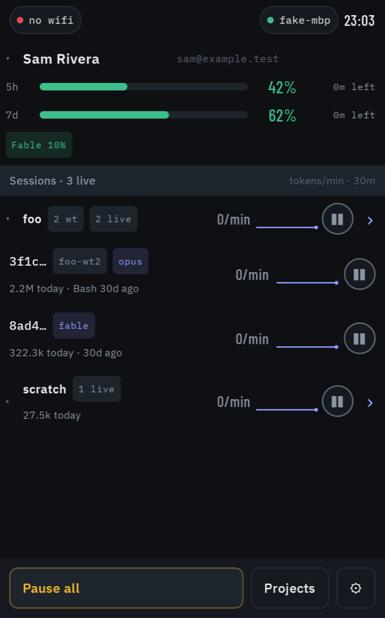
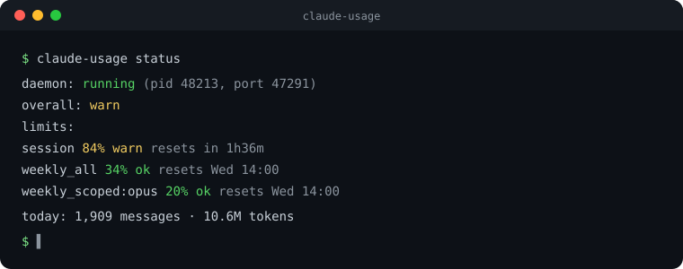
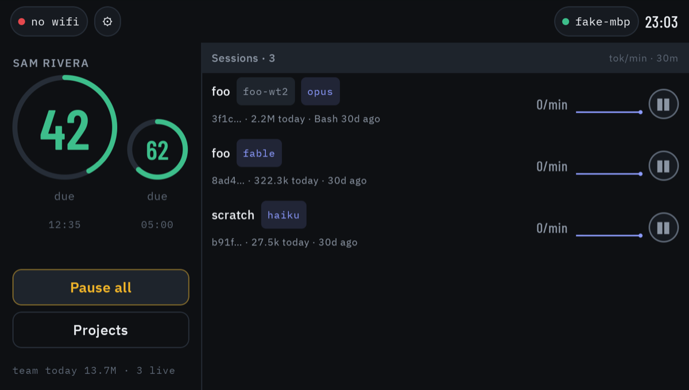

<!-- SPDX-License-Identifier: MIT -->
<!-- Copyright (c) 2026 Even Seal Productions -->

<div align="center">

# claude-usage

**Know how close your Claude account is to its limits — in your terminal, inside Claude Code,
and on your phone and wrist.**

[](https://github.com/drmuzikbpn/claude-utilization-mcp/actions/workflows/ci.yml)
[](LICENSE)


&nbsp;

&nbsp;


*Works with Claude Code. Not affiliated with, endorsed by, or sponsored by Anthropic.*

</div>

---

`claude-usage` is a small background service for macOS and Linux. It reads the same usage
numbers `/usage` shows, adds up the tokens your Claude Code sessions spend, and puts both
where you need them:

- **Inside Claude Code** — a one-line warning when a window is getting tight, and MCP tools a
  session can call to check its own budget and slow down before it hits the wall.
- **In your terminal** — `claude-usage status`, token totals by project or model, and pause or
  resume any running session.
- **On your phone, watch and desk** — the free **Usage Deck** apps show every account's rings,
  every live session and its burn rate, and pause or freeze sessions with a tap.

It never sends your data anywhere: the only outside calls are Anthropic's own usage endpoint
and GitHub, to check for signed updates. Phones reach it over your own Wi-Fi with HTTPS pinned
to the daemon's certificate.

<p align="center">
  
</p>

## Install

You need **Node 20+** and **Claude Code** signed in on the machine.

```bash
git clone https://github.com/drmuzikbpn/claude-utilization-mcp.git
cd claude-utilization-mcp
npm ci && npm run build
node bin/claude-usage install
```

`install` explains each change and asks before making it. It starts the background service,
adds the Claude Code hook and MCP server, and puts `claude-usage` on your PATH. You can delete
the checkout afterwards: the service keeps itself up to date from signed GitHub releases.

Check it worked:

```bash
claude-usage status
```

Remove everything again with `claude-usage uninstall`.

## Add your phone

1. Get the app:
   - **iPhone + Apple Watch** — *Usage Deck* on TestFlight (invite only for now; ask the
     maintainer). The watch app comes with it.
   - **Android** — the *Usage Deck* APK from the [`deck-` releases](https://github.com/drmuzikbpn/claude-utilization-mcp/releases).
     It updates itself after that.
2. On each machine you want to see, run:

   ```bash
   claude-usage pair
   ```

3. Scan the QR code it shows. That's it — the code works once and expires in five minutes,
   and the token it unlocks never appears on screen.

## Screenshots

| iPhone | Apple Watch | Android desk phone |
| :---: | :---: | :---: |
|  |  |  |
| Drill into a project's sessions and burn rate | Projects at a glance | A wall or desk dashboard in landscape |

<p align="center">
  
</p>

All screenshots use made-up demo data.

## Learn more

| | |
| --- | --- |
| [**Full guide**](docs/guide.md) | Every command, the hook, MCP tools, status line, configuration, auto-update, troubleshooting |
| [**Security model**](docs/security.md) · [**SECURITY.md**](SECURITY.md) | What the token protects, pinning, signed releases, how to report a vulnerability |
| [**HTTP API**](docs/api.md) | Every endpoint, error envelope and the live event stream, for building your own client |
| [**iPhone & Apple Watch app**](https://github.com/drmuzikbpn/claude-utilization-mcp/tree/usage-ios) | Source on the `usage-ios` branch |
| [**Android app**](https://github.com/drmuzikbpn/claude-utilization-mcp/tree/usage-android) | Source on the `usage-android` branch |
| [**Contributing**](CONTRIBUTING.md) · [**Changelog**](CHANGELOG.md) | How to build, test and send a change |

## License

MIT © 2026 Even Seal Productions — see [LICENSE](LICENSE). Claude and Claude Code are
trademarks of Anthropic.
