# Usage Deck for iPhone and Apple Watch

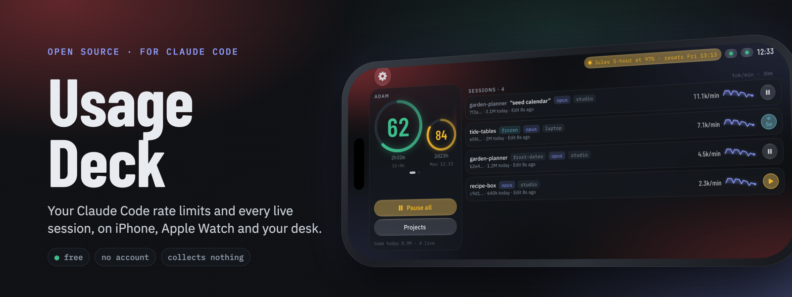

Not affiliated with Anthropic.

See how close your Claude account is to its 5-hour and 7-day limits, how many tokens your Claude
Code sessions are burning, and pause or freeze sessions — from your iPhone, your lock screen and
your wrist.

Usage Deck does not talk to Anthropic. It reads everything from
[`claude-usage`](https://github.com/drmuzikbpn/usage-deck), a small daemon you run on
the computer where you use Claude Code (macOS or Linux), and talks only to that device.

## What it looks like

Every picture here is the app's demo mode: made-up devices, accounts and projects.

| Ledger | Expanded project | Project | Device | Pairing |
| --- | --- | --- | --- | --- |
| 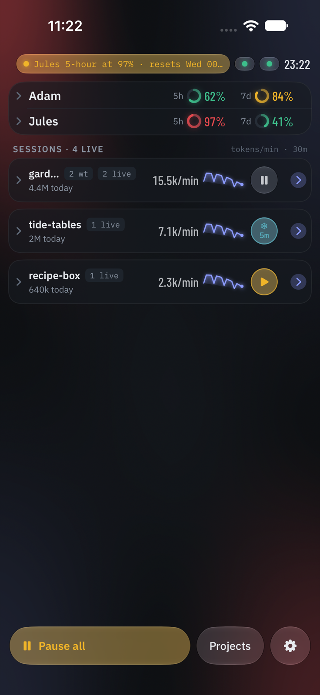 | 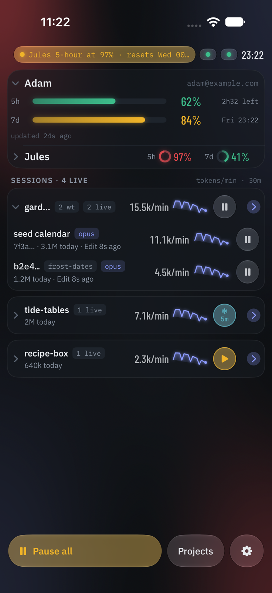 | 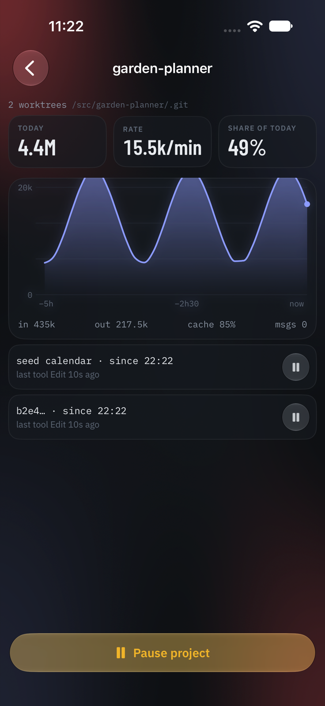 | 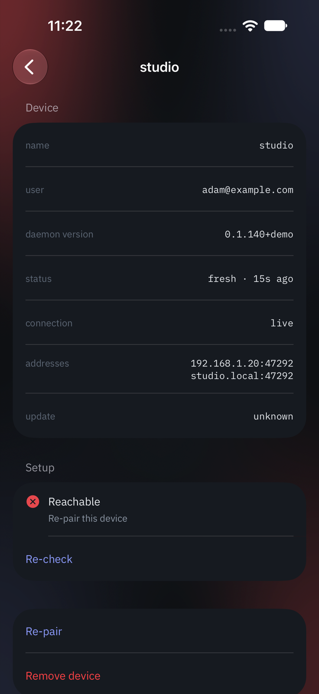 | 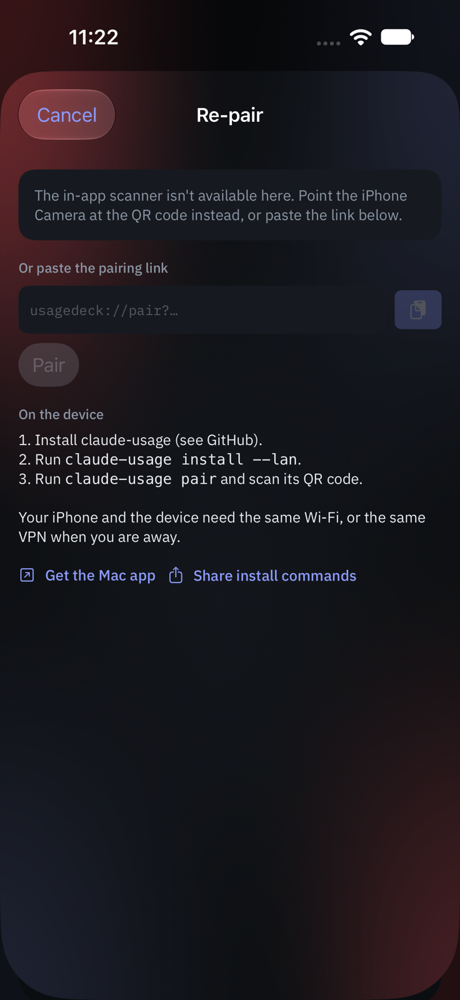 |

Landscape turns the iPhone into the wide dock, the way it looks best on a desk stand, and every
screen follows it round:

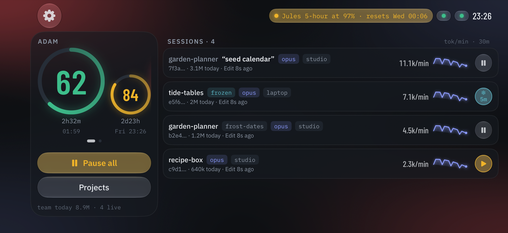 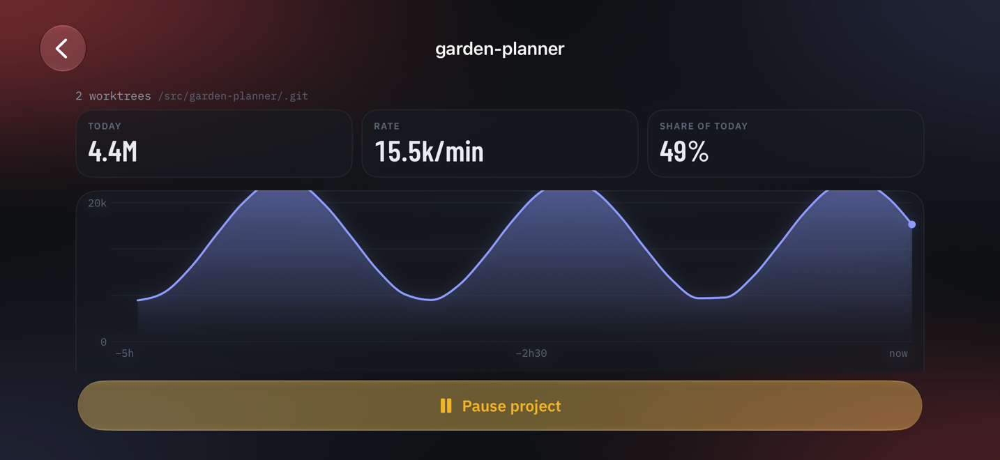

A re-pair that would change a device's certificate says so first:

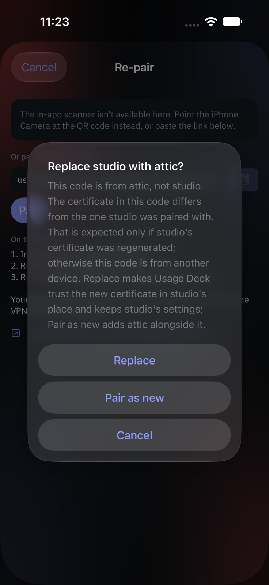

Widgets (small, medium, and the lock-screen circular, rectangular and inline families):

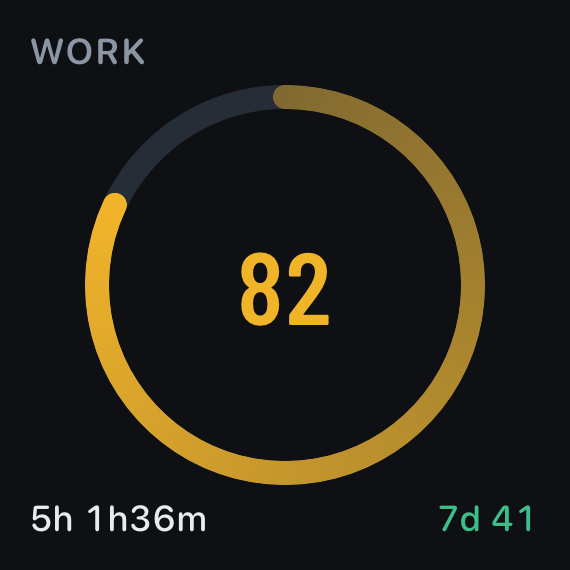 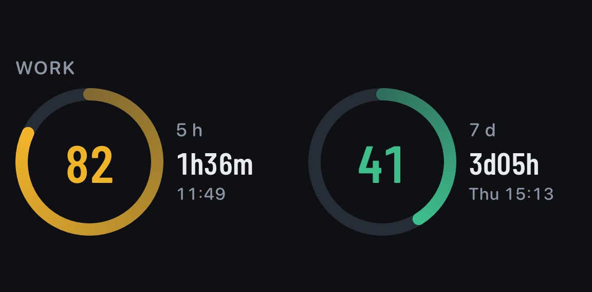 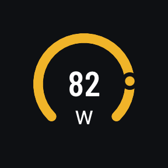 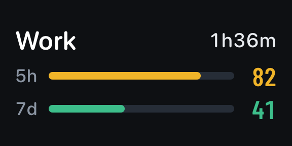 

Apple Watch: an account page, the projects list, a project, the actions page, and the
complications (circular, rectangular, corner, inline):

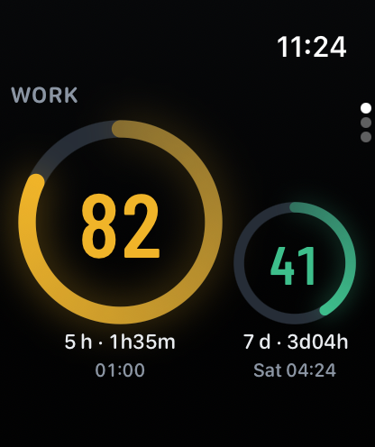 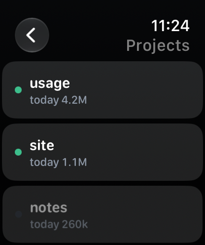 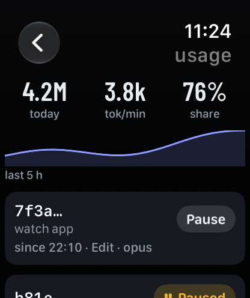 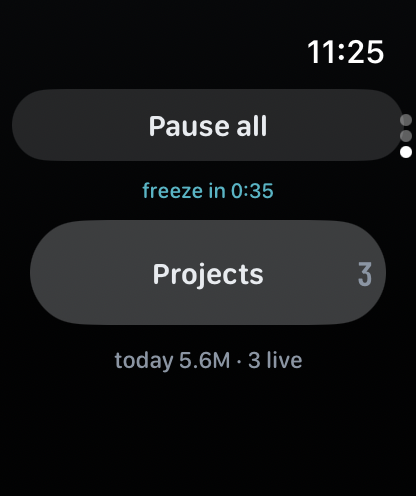

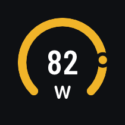 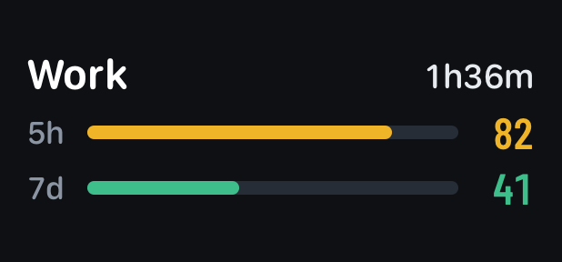 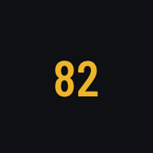 

## Pair a device

1. Install `claude-usage` on the device: see
   <https://github.com/drmuzikbpn/usage-deck>.
2. Turn on local-network access: `claude-usage install --lan`.
3. Run `claude-usage pair`. It opens a page with a QR code.
4. Point the iPhone Camera at the QR and tap **Open in Usage Deck**. (Or scan it from inside the
   app.)

Pairing happens over HTTPS pinned to the device's own certificate, and the QR holds a one-time
code that expires after five minutes — it never contains your access token. When you re-pair a
device and the code carries a different certificate from the one you paired, the app says so
before it replaces anything: continue only if you ran `claude-usage pair` on that device yourself. Your iPhone and the
device need to be on the same Wi-Fi, or on the same VPN (Tailscale works) when you are away.

The Apple Watch app needs no setup: it gets everything from the iPhone, never from the device
directly.

## Removing a device, or losing the iPhone

Each paired device gives the iPhone an access token, kept in the iPhone Keychain (this iPhone
only: never iCloud, never the watch). Removing a device in Usage Deck deletes the iPhone's copy,
and the app also deletes any stored token that no paired device owns the next time it opens (the
Keychain outlives an uninstall). **Neither revokes the token**: the daemon still accepts it.

To revoke access — after removing a device you no longer trust this iPhone with, or if the
iPhone is lost, sold or stolen — run this on **each** paired machine:

```bash
claude-usage configure rotate-token
```

That replaces the daemon's token, so every phone paired with that machine stops being accepted;
pair the ones you still use again with `claude-usage pair`.

## Building

```bash
brew install xcodegen swiftlint swiftformat lefthook
lefthook install            # lint, licence headers and scripts/public-check.sh on every commit
(cd Packages/UsageCore && swift test)
xcodegen generate
xcodebuild -project UsageDeck.xcodeproj -scheme UsageDeck -destination 'generic/platform=iOS Simulator' build
```

With nothing paired, **Try the demo** on the home screen shows the same made-up data in any
build. Launch a Debug build with the `-UsageDeckDemo` argument to see the app filled with made-up
devices and no daemon; the UI smoke test (`xcodebuild ... test`) does exactly that.

Requires Xcode with the iOS 18 and watchOS 11 SDKs or later. Design:
[`docs/superpowers/specs/2026-10-01-usage-ios-design.md`](docs/superpowers/specs/2026-10-01-usage-ios-design.md).
Privacy: [`PRIVACY.md`](PRIVACY.md). Licence: [MIT](LICENSE); the bundled fonts are under the SIL
Open Font License (`App/Resources/Fonts/OFL.txt`, `SharedUI/Fonts/OFL.txt`).
