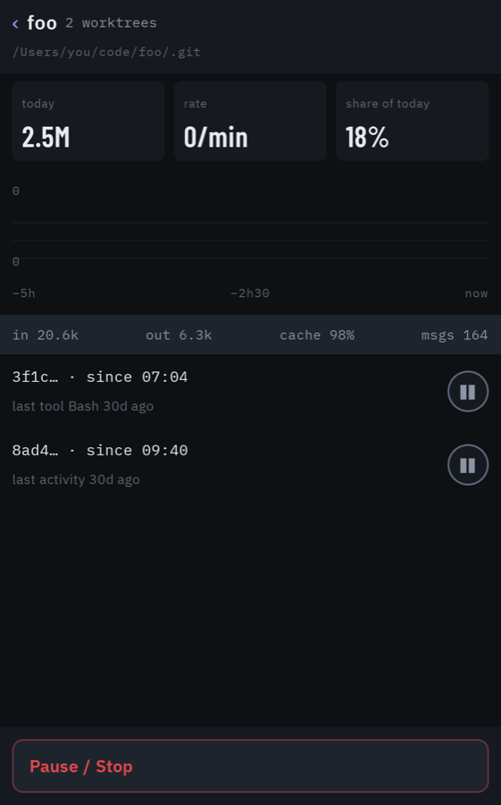
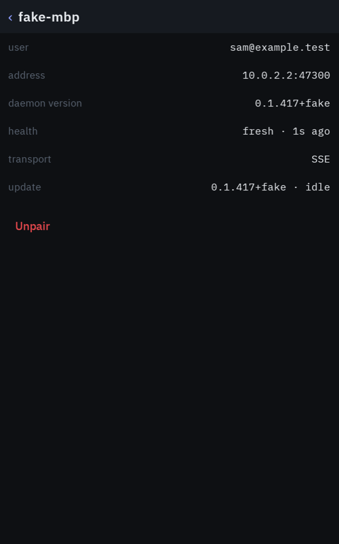
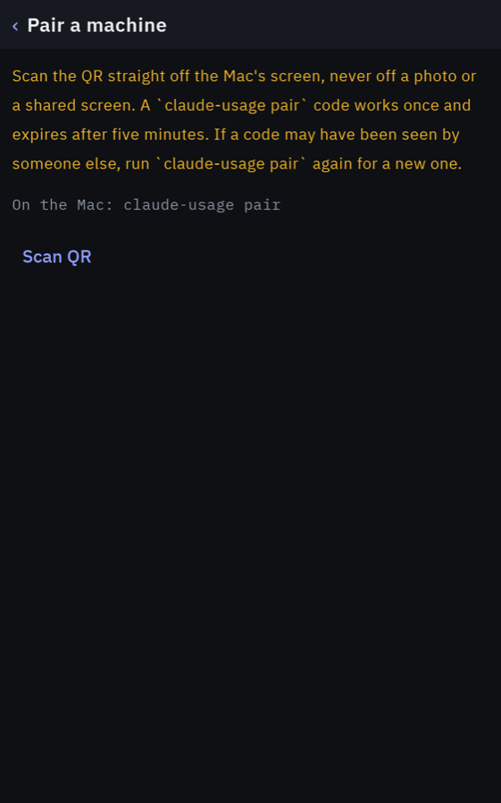

# Usage Deck

Not affiliated with Anthropic.

A Nexus 5X running LineageOS, bolted to a shelf, showing what every Claude Code session on the
team is burning right now — and letting you stop one with a thumb.

It is a Device Owner kiosk launcher: it streams from N `claude-usage` daemons over Tailscale,
merges them into one view, and can soft-pause or hard-freeze a session, a project, or everything
at once.

| Ledger (portrait) | Project drill-in | Machine | Pairing |
| --- | --- | --- | --- |
|  |  |  |  |


*Screenshots are from the emulator against the fake daemon: every name and number in them is
synthetic.*

## What it does

- **Ledger (portrait)** — one folded line per person (`5h 42%  7d 18%`; tap to unfold the bars,
  reset times and model-scoped windows), then every live session grouped by project. Project rows
  start folded with a project sparkline and a project pause; tap to see the sessions. Sessions show
  their `/rename` title when they have one.
- **Wide dock (landscape)** — the same data as numbers big enough to read across a room. With
  more than one account paired, the rings page sideways: swipe to the next account, its name
  above the circles. Several machines on one account are one quota and stay one page.
- **People** — quotas are per account *and* organisation, so one account on a team seat and on a
  personal plan is two rows. Long-press a row (or use *Settings › Users*) to name it.
- **Pause** — tap for a soft pause, hold 600 ms to freeze. A soft pause holds the session at its
  next tool call and escalates to a freeze after 90 s unless you resume it. A freeze stops the
  tool that is running and holds the next one; the Claude Code process itself keeps running, so
  the terminal is never suspended. A freeze longer than the session's tool timeout (2 min by
  default) ends the tool that was running. Red styling appears only while you are actually holding.
- **Settings (gear)** — wifi, keep-screen-on, auto-dim at night, 12/24 h clock, alert chime, user
  names, thresholds, escalation, quiet hours, exit PIN and updates.
- **Alerts** — full-screen in the dock, heads-up notification on battery, silenced (but still
  visible) during quiet hours.
- **Self-update** — polls its own GitHub releases every 10 minutes and installs silently as Device
  Owner — but never while a gesture or an escalation is in flight. Before installing it checks
  the sha256, that the APK is this app with a higher version code, and that it is signed by the
  key the installed app trusts; a release that fails is skipped, not retried every ten minutes.

## Modules

| Module | What it is | Tests |
| --- | --- | --- |
| `core` | Pure Kotlin/JVM: model, daemon client, SSE, pinned TLS + pairing redeem, team merge, pause state machine, alerts, update check | 193 |
| `app` | Android: kiosk, wifi, pairing, Compose UI, foreground service, installer | 155 unit + 42 instrumented |
| `fakedaemon` | Ktor server implementing the daemon contract with scripted scenarios | 19 |

## Build and run

```bash
export JAVA_HOME=/opt/homebrew/opt/openjdk@17
export ANDROID_HOME=/opt/homebrew/share/android-commandlinetools

./gradlew :core:test :fakedaemon:test :app:testDebugUnitTest   # JVM + Robolectric
./gradlew :app:assembleDebug
./gradlew ktlintFormat                                          # before every commit
```

Instrumented tests need a device. A real Nexus 5X and the emulator are usually both attached, so
**always pin the serial**:

```bash
scripts/emulator.sh                                             # starts/creates the deck29 AVD
ANDROID_SERIAL=emulator-5554 ./gradlew :app:connectedDebugAndroidTest
```

## Running without a Mac

`fakedaemon` implements the daemon contract — pinned HTTPS, `claude-usage pair` links and all — so
the app runs on an emulator with nothing else:

```bash
scripts/fakedaemon.sh warnCrossing      # also: idle, freeze, machineDrop, tokenRotated
scripts/pair-emulator.sh                # in another terminal: pairs the debug build on the emulator
```

The fake listens on loopback only (the emulator reaches it as `10.0.2.2`), prints a single-use
pairing link, and generates a fresh token for every run; there is no fixed token.
`scripts/pair-emulator.sh` pushes that link to the place a **debug** build watches for one, and
refuses any serial that is not an emulator. To let a device on the network reach the fake, opt in
explicitly: `BIND=0.0.0.0 ADDRS=<this machine's address> scripts/fakedaemon.sh`.

## Pairing a Mac

On any Mac running the `claude-usage` daemon (from `main` of this repo, reachable on the LAN or
over Tailscale):

```bash
claude-usage pair
```

That prints a QR code. On the deck, tap **Pair** on the home screen (or, once a machine is paired, *Settings › Pair a machine*), then **Scan QR**, and hold the phone up
to the Mac's screen. The QR carries no token: it holds the daemon's addresses, its HTTPS port,
the SHA-256 pin of its certificate and a one-time code that expires after five minutes. The deck
redeems the code over HTTPS pinned to that certificate (`POST /v1/pair`, daemon §23.47), and from
then on talks to that Mac over pinned HTTPS only, falling back across its LAN, `.local` and
tailnet addresses.

There is no other way to pair. The older `claude-usage configure pairing` QR, which carried the
bearer token itself for plain HTTP, is no longer accepted, and the deck has no plain-HTTP path to
a daemon at all. A machine that was paired that way stays on the deck as an amber "needs to be
paired again" card: run `claude-usage pair` on it and tap **Re-pair**. Its row keeps its
identity, so pause escalations and history carry over.

Repeat for each Mac; the deck merges them into one view. The full walkthrough, including
Tailscale and the troubleshooting table, is in
[docs/teammate-onboarding.md](docs/teammate-onboarding.md).

**If the phone is lost or stolen**, run `claude-usage configure rotate-token` on every machine it
was paired with, then pair the replacement. See [SECURITY.md](SECURITY.md).

## Setting up a phone

See **[docs/device-setup.md](docs/device-setup.md)** — flashing LineageOS 17.1, skipping
provisioning, `dpm set-device-owner`, Tailscale, and the one-tap Doze exemption.

Teammates adding their own Mac want **[docs/teammate-onboarding.md](docs/teammate-onboarding.md)**.

Before shipping a release that touches kiosk, wifi, pairing or update, run
**[docs/smoke-test.md](docs/smoke-test.md)** on the real phone.

## Releases

The app lives on the `usage-android` branch of the daemon's repo, `drmuzikbpn/claude-utilization-mcp`.
CI has two jobs. `test` runs for every pull request and push with a read-only token and no
secrets: the public-repository check, ktlint, all JVM tests and the instrumented suite on an
API 29 emulator. `release` runs only for a push to `usage-android`, after `test`, inside the
`release` environment: it assembles the release, signs it with `apksigner`, and publishes it with
`gh release create` under the namespace the two updaters agreed on (daemon spec §23.17): tag
`deck-<version>`, assets `usage-deck.apk` and `usage-deck.apk.sha256`, always flagged pre-release
so the daemon's `/releases/latest` never returns an APK. Without the signing secrets it publishes
nothing. The deck's updater lists releases and considers `deck-` tags only, so a daemon tarball
never looks installable to it.

Versions are `0.MINOR.<commit-count>+<short-sha>`; `versionCode` is the commit count.

The workflow reads the signing secrets `SIGNING_KEYSTORE_B64`, `SIGNING_KEY_ALIAS` and
`SIGNING_STORE_PASSWORD` (and `SIGNING_KEY_PASSWORD`, only if the key's password differs from the
store's). Keep them in the `release` environment rather than at repository level, so only the
release job can read them. CI signs with `app/signing/usage-deck.lineage`, a rotation from the key
the phone was first provisioned with, so releases install over it in place; the story is in
[docs/device-setup.md](docs/device-setup.md) under *Release signing*.

Every GitHub Action is pinned to a commit, the Gradle wrapper verifies its distribution's
checksum, and a pre-commit hook (`scripts/public-check.sh`, via lefthook) refuses a commit that
adds a credential, a private address or path, or an unlisted e-mail address.

## Security

How pairing, storage, the kiosk and updates are protected, what they do not protect against, and
how to report a problem: [SECURITY.md](SECURITY.md).

## Licence

MIT — see [LICENSE](LICENSE). The bundled Barlow and IBM Plex fonts are under the SIL Open Font
License, and the libraries the app ships are under Apache-2.0: see
[THIRD_PARTY_NOTICES.md](THIRD_PARTY_NOTICES.md) and [`licenses/`](licenses/).
